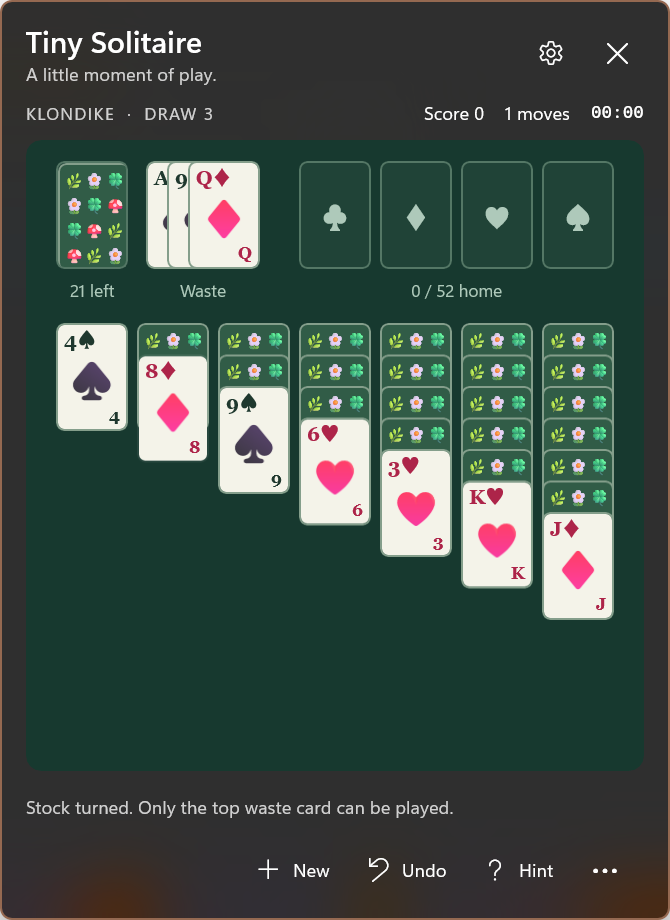
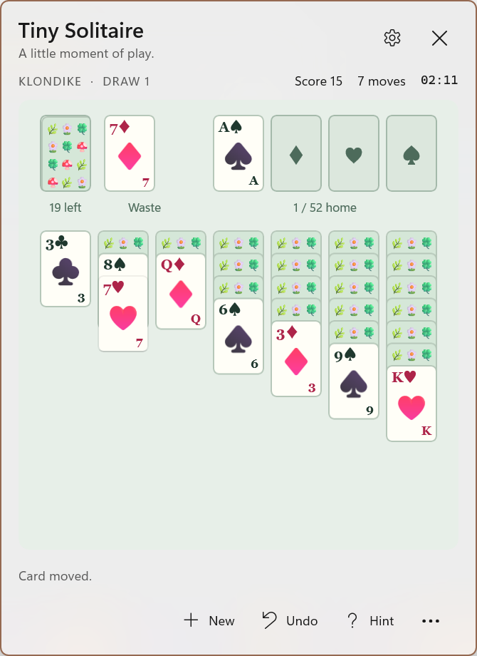

# Tiny Solitaire

A little game of Klondike, always one click away in your Windows tray.




## Just you and the cards

- Classic Klondike with draw-one or draw-three and unlimited trips through the stock.
- Click a card and its destination, drag cards or complete runs, or double-click a card to send it to a foundation. Cards glide between piles when drawing, moving, undoing, or dealing again; auto-finish plays its moves in sequence. Dragged cards lift off the table and follow your cursor from the spot you grabbed. Drops use the card's overlap with a pile, with forgiving edges and the space below each column available too; invalid drops or `Esc` glide cards back to their pile. Motion respects Windows animation settings.
- Undo the last 100 moves, ask for a hint, restart the same deal, or start a new one.
- Auto-finish from the overflow menu once the stock and waste are empty and every tableau card is face up.
- Win a deal for a colorful fireworks celebration lasting about eight seconds. With Windows animations disabled, a quiet "You won!" message appears instead.
- A distraction-free table: just the cards and an icon-only command row, with hints and settings available on demand.
- Four repeating emoji card backs: **Emoji garden**, **Stargazer**, **Fruit salad**, and **Cat nap**.
- **Green** appearance by default fills the entire flyout with classic solitaire green. **Light**, **Dark**, and **System** are also available. System follows the taskbar theme; the tray icon always follows the taskbar, independently of your game preference.
- Automatic local saving, including undo history. Pick up where you left off after dismissing or restarting the app.
- Optional **Start with Windows**, off by default.

Left-click the tray icon to open or hide the game. Right-click for **Open Tiny Solitaire**, **Settings**, and **Exit**. Closing the flyout hides it; only **Exit** quits. Settings live inside the same flyout.

Draw-count changes apply to the next new game, not to the active deal. Replacing a game in progress requires confirmation.

| Shortcut | Action |
| --- | --- |
| `D` | Draw or recycle the stock |
| `H` | Show a hint |
| `Ctrl+Z` | Undo |
| `Ctrl+N` | New deal |
| `Esc` | Back from settings, deselect a card, or hide to tray |
| `Alt+Left` | Back from settings |

Build columns down in alternating colors; only kings fill empty columns. Foundations build from ace to king in one suit. Scoring gives +10 for a foundation move, +5 from waste to tableau, and +5 for revealing a card. Returning a foundation card costs 15; recycling costs 100 in draw-one or 20 in draw-three. Scores never go below zero.

## Install

[](https://github.com/Tray-Land/tiny-solitaire/releases/latest/download/TinySolitaire.appinstaller)

Requires **Windows 10 2004 or later, or Windows 11**, on **x64 or ARM64**.

Download [TinySolitaire.appinstaller](https://github.com/Tray-Land/tiny-solitaire/releases/latest/download/TinySolitaire.appinstaller) and open it. Windows installs the right version for your PC and keeps it updated. There is no Store listing yet, or you can build from source below.

## Privacy and footprint

No accounts, API keys, analytics, advertising, or network requests. Everything happens on your device.

Your deal is written atomically to `%LOCALAPPDATA%\Packages\<package-family>\LocalState\game.json`. Preferences use the package's local settings. Invalid saved games are rejected with a visible warning rather than crashing. Unhandled exception diagnostics are written to `%TEMP%\TinySolitaire-crash.log`.

There is no hidden polling or game-clock timer. A dismissed flyout stays warm briefly for instant reopening, then closes after one minute and releases idle memory. The app keeps only its tray icon and single-instance plumbing alive.

## Build from source

Install the **.NET 10 SDK**, the Windows App SDK C# development tools, and **WinApp CLI 0.7+**:

```powershell
winget install Microsoft.WinAppCli
winapp run . --detach
```

The project is a packaged WinUI 3 app scaffolded with `winapp new`. Use `winapp run`, not a direct executable launch. A second launch signals the running instance to open the flyout. `winapp run --clean` resets the development app's saved games and preferences.

Run the platform-independent rules tests:

```powershell
dotnet test .\tests\TinySolitaire.Tests.csproj
```

Run the local UI acceptance script on an unlocked desktop:

```powershell
pwsh -File .\scripts\ui-tests.ps1
```

Start a fresh deal before the full UI suite. The script changes game progress and preferences, exercises input on the local desktop, and writes screenshots and structured results under `artifacts\ui-tests`. Use `-TestFilter 'emoji|green'` for focused checks or `-AppPid <id>` to reuse a running instance.

To publish a release, bump `Identity/@Version` in `Package.appxmanifest`, push, then run `.\build-msix-for-gh.ps1`. It builds a signed x64 + ARM64 `.msixbundle` plus the `.appinstaller` feed and creates a draft GitHub release. Publish the draft without changing its tag, then run `.\build-msix-for-gh.ps1 -VerifyPublished`. `-SkipRelease -NoSign` checks the build without signing or publishing.

For a release build and launch:

```powershell
winapp run . -c Release --detach
```

`build-msix-for-gh.ps1` builds signed x64 and ARM64 MSIX packages and can publish a GitHub release once a repository, signing certificate, and release configuration are available. Use `-SkipRelease` to package without publishing.

Pure rules and source-generated save serialization live in `Game\`; the test project links those files without loading WinUI. Supplied suit artwork is in `Assets\Suits`, and tray-icon source artwork is in `branding`.

## License

MIT, see [LICENSE](LICENSE).
